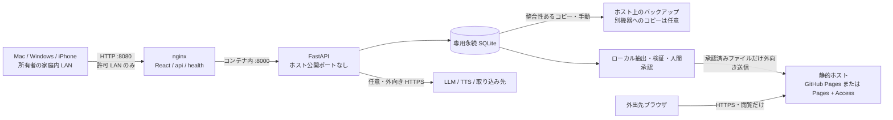

# ADR 0001: 家庭内の本番学習と外出先の読み取り専用教材

- 日付: 2026-10-20
- 状態: 設計選定済み・レビュー待ち。実装、運用開始、公開の承認ではない
- 対象: [#210](https://github.com/Yuki-Watanabe7/french-begginer/issues/210)、親 [#209](https://github.com/Yuki-Watanabe7/french-begginer/issues/209)
- 方針の所有者: 利用者兼運用担当 Yuki-Watanabe7
- 配布判断: [PCP #51](https://github.com/Yuki-Watanabe7/portfolio-control-plane/issues/51)、運用証跡: [PCP #56](https://github.com/Yuki-Watanabe7/portfolio-control-plane/issues/56)

## 決定

1. 家庭内の本番は、開発用とは別の単一 Compose プロジェクトで動かす。nginx が React のビルド結果と同一オリジンの `/api` を配信し、FastAPI はコンテナ間通信だけ、SQLite は専用の永続ボリュームに置く。
2. 外出先には、本番アプリから切り離した静的な教材ビューアーと、許可した項目だけの固定データを配る。この固定データを本プロジェクトでは「Snapshot」と呼ぶ。回答記録、LLM 抽出、TTS、音声取り込みは外出先に提供しない。
3. **一般公開を人間が明示承認した教材は GitHub Pages を第一候補**とする。個人の復習予定・苦手情報が必要なら **Cloudflare Pages + Access を条件付き候補**とする。対象読者が未決定の間は外部へ送信しない。安さだけを理由に個人教材を公開へ切り替えない。
4. 外部配布を承認できない場合は、家庭内利用を続け、端末への事前保存を代替案とする。オフライン対応には別の実装・実機検証が必要。VPN による本番への遠隔アクセスは、利用者が将来希望したときの別判断とする。
5. ~~日次の整合性ある SQLite バックアップと、暗号化した別機器へのコピー、実際の復元訓練を運用開始条件にする。~~ **2026-11-01 改訂（[#209](https://github.com/Yuki-Watanabe7/french-begginer/issues/209) / [#220](https://github.com/Yuki-Watanabe7/french-begginer/issues/220)）**: 本番 SQLite を開発用と分けた永続 volume に置き、手動で取れる整合バックアップと基本の復元手順を用意する。暗号化・別機器コピー・世代管理・復元演習・RPO / RTO は運用開始の条件にしない。最後のバックアップより後の更新や PC 故障による喪失は、個人利用の割り切りとして所有者が許容する。外部の教材はバックアップではない。

本 Issue では文書と後続作業の登録だけを変更する。Compose、認証、CI の配布設定、アカウント、ドメイン、本番 DB は変更しない。

## 実コードの監査結果

監査基準は `87bac7361e217e4f6ec7c90ec65233c087dbb730`。実データや `.env` の内容は調査・転記していない。

| 根拠 | 現状と設計への影響 |
|---|---|
| [`docker-compose.yml`](../../docker-compose.yml) | 両サービスは `target: dev`、ソースを bind mount、5173 と 8000 をホストに公開。固定 LAN アドレスへの限定、再起動ポリシー、本番専用ボリュームは未設定 |
| [`frontend/Dockerfile`](../../frontend/Dockerfile) | `prod` の nginx stage は既に存在する。ただし静的ファイルのコピーのみで、API 中継、ヘルス確認、アクセス制限の設定はない |
| [`backend/Dockerfile`](../../backend/Dockerfile) | 最終 stage は `dev`、uvicorn は `--reload`。root 実行で開発依存も含む。本番 stage、固定した依存、非 root・書込先限定が必要。`[dev]` 指定と pyproject の dependency group の整合も Phase 1 で直す |
| [`frontend/vite.config.ts`](../../frontend/vite.config.ts) | 開発時だけ `/api` と `/health` を `backend:8000` に中継。`VITE_API_BASE` はこの proxy 設定を変更しない |
| [`frontend/src/api/client.ts`](../../frontend/src/api/client.ts)、[`tutor.ts`](../../frontend/src/api/tutor.ts)、[`useTTS.ts`](../../frontend/src/hooks/useTTS.ts) | `VITE_API_BASE` をビルド時に埋め込み、未指定なら同一オリジン。既存 React 画面には書込 API 呼出しと TTS GET があり、そのまま静的公開できない |
| [`backend/app/main.py`](../../backend/app/main.py)、[`api/deps.py`](../../backend/app/api/deps.py) | CORS は origin/method/header すべて `*`。利用者認証はない。`Depends` はサービス注入であって認証ではない。`GET /health` は `{"status":"ok"}` を返すだけで DB の正常性は測らない |
| [`persistence/config.py`](../../backend/app/persistence/config.py)、[`db.py`](../../backend/app/persistence/db.py) | `TUTOR_DATABASE_URL` が `TUTOR_DATA_DIR` より優先。既定は `backend/data/tutor.db`（コンテナでは `/app/data/tutor.db`）。親ディレクトリ作成と FK 有効化はあるが、運用バックアップはない |
| [`persistence/schema.py`](../../backend/app/persistence/schema.py) | 現行 schema version は 5。初回 `create_all`、旧版は `UPGRADE_STEPS` で起動時に更新し、新しすぎる DB は拒否。アプリだけの巻戻しでは DB を戻せない |
| [`domain/tutor.py`](../../backend/app/domain/tutor.py)、[`persistence/models.py`](../../backend/app/persistence/models.py) | Source 本文・来歴、LearningItem の metadata/source_refs、学習履歴・状態・方向別復習予定がある。API 応答や DB 行の丸ごと JSON 化は禁止 |
| [`tts_service.py`](../../backend/app/services/tts_service.py)、[`openai_extractor.py`](../../backend/app/services/openai_extractor.py)、[`audio_api.py`](../../backend/app/ingestion/audio_api.py) | OpenAI キーと処理は backend 側。TTS は GET でも外部 API 費用が発生する。静的側の「GET のみ」だけでは読み取り専用を保証できない |

ファイアウォール、ルーター、LAN 認証、実機の接続性、Docker の自動起動・ホストの睡眠設定はリポジトリから確認できない。いずれも運用開始前の実測事項で、現状を安全な本番と判定しない。README の Codespaces 公開ポート手順は開発用で、本番や個人 DB の実機確認には使わない。

## 対応端末と通信の境界

初期ホストは利用者管理の Mac + Docker Compose v2。Windows はブラウザ端末として対応する。Windows ホスト + Docker Desktop/WSL2 は同じ設計の代替候補だが、起動とボリューム権限を別途検証するまで対応済みとしない。ブラウザは現行安定版の Safari（Mac/iPhone）、Edge（Windows）、Chrome。実測時の OS・ブラウザ・Docker の版を記録する。複数端末は同じ一人の学習履歴を共有し、複数利用者のデータ分離は扱わない。

外部から自宅への矢印は存在しない。ルーターのポート転送、UPnP による穴開け、公開トンネル、外部静的サイトから LAN API への接続は許可しない。外向きの LLM 呼出しには入力が提供者へ送られ費用が発生するため、「キーがホストにある」ことを「データが外へ出ない」と解釈しない。

## 家庭内の構成比較

| 選択肢 | 手間・費用 | 永続性・隔離 | 判断 |
|---|---|---|---|
| 専用 Compose + nginx + FastAPI + SQLite | 既存 PC、電力、Docker の保守。クラウド常駐費なし | 入口 8080 だけ。DB と開発環境を分離し復旧手順を固定できる | **採用**。設定は Phase 1/2 で実装 |
| 既存 dev Compose | 追加設定が少ない | ソース mount、Vite、reload、8000 直接公開、開発 DB の混在 | 開発専用。本番として継続しない |
| ホストで nginx + uvicorn を直接実行 | Docker の負荷を省ける | 専用 OS ユーザー、venv、launchd/Windows サービス、依存と起動順を手管理 | Docker を維持できない場合の代替。即席の `uvicorn --reload` は採用しない |

本番専用ファイル（予定名 `compose.production.yml`）は dev の上書きにせず、明示指定して起動する。nginx は既定 8080、backend 8000 はホスト非公開。React の `VITE_API_BASE` は空、nginx は `/api` のパスを保持して中継し `/health` を明示中継、静的画面の直接再読込も確認する。ソース bind mount と Vite を含めない。backend は非 root、コードを読取専用とし、SQLite ディレクトリと必要な一時領域のみ書込可、単一 worker とする。依存とイメージを固定し更新手順を設ける。

初期は **所有者が信頼する家庭内 LAN のみ・利用者認証なし**を選ぶ。LAN に到達した端末は全機能と API 費用を利用できるため、所有者によるこの残余リスクの受入を Phase 1 の運用開始条件にする。HTTP は LAN 内の盗聴・改変を防がない。共有 LAN、来客端末、信頼できない IoT を隔離できない場合は起動を localhost に限定し、HTTPS + 入口認証の設計を先に追加する。HTTP 上に Basic 認証だけを足して安全としない。

同一オリジン利用で本番 CORS の全許可を削除する。加えて許可 Host、書込・有料 API の Origin/Fetch Metadata 検証を実装し、別サイトからの送信と DNS rebinding を拒否する。これらはブラウザ経由の悪用対策で、LAN 利用者認証ではない。ファイアウォールは信頼 LAN サブネットだけを許可し、IPv6 と Docker 公開ポートの実際の到達範囲も別端末で検査する。

名前解決は DHCP 予約による固定 LAN IPv4 を主経路とする。`french-host.local` の mDNS は補助で、Windows や WiFi の分離設定次第で使えないため必須にしない。スリープ中は家庭内学習不可、再起動後は Docker とアプリの両方の起動を要する。24時間稼働は約束しない。

## 外出先の構成比較と費用

以下は 2026-10-20 の公式仕様確認による設計判断。利用者の契約・支出を確認した結果ではない。

| 選択肢 | 読者・家庭 PC 停止中 | 継続費用と制約 | 判断 |
|---|---|---|---|
| GitHub Pages | **公開承認済みの一般教材**。PC 停止中も最終版を閲覧可 | Free は公開 repo、Pro 等は private source 対応。ソースが private でも通常のサイトは公開。追加契約不要かは未確認 | 公開教材の第一候補。repo の公開化を暗黙に行わない |
| Cloudflare Pages + Access | 許可した本人だけ。PC 停止中も最終版を閲覧可 | Pages の無料枠と Access の契約枠を別々に確認。認証・全 URL 保護の保守が増える | 個人情報を含む必要性と外部保存が承認された場合に選ぶ |
| 事前保存・PWA/cache | 保存済み端末だけ。未保存端末・消えた cache は利用不可 | 外部ホストなしで構成できるが LAN HTTPS と証明書の端末導入、更新・保存確認の手間 | 公開不可・契約不適合時の代替。現状にオフライン機能はない |
| VPN（Tailscale 等） | private 本番への遠隔接続。PC 停止中は不可 | VPN の契約枠、端末管理、ホスト稼働を要する。価格・アカウント未調査 | 本件では保留。静的教材の要件を満たす代替に数えない |

GitHub Pages は [Free/Pro とソース repo の条件](https://docs.github.com/en/pages/getting-started-with-github-pages/creating-a-github-pages-site)を確認する。private site のアクセス制御は [Enterprise 組織向けの別機能](https://docs.github.com/en/enterprise-cloud@latest/pages/getting-started-with-github-pages/changing-the-visibility-of-your-github-pages-site)で、個人 Pro と混同しない。通常の公開サイトの JS/JSON は誰でも保存でき、`noindex`、隠した URL、JS ログイン画面、JS 同梱の復号鍵はアクセス制御にならない。

Pages 自体の目安は [サイト 1 GB、帯域 soft limit 月 100 GB](https://docs.github.com/en/pages/getting-started-with-github-pages/github-pages-limits)。本用途は遥かに小さなテキストに制限する。既存 repo 全体を public にする必要はなく、必要なら承認した別の公開教材 repo を使うか、対応する private source + Actions artifact で配布する。個人 Snapshot を Git 履歴へ保存しない。[Actions 課金仕様](https://docs.github.com/en/billing/concepts/product-billing/github-actions)には標準 runner の Pages 用実行の無料扱いがある一方、private repo の通常 CI、別の生成・検査 job、artifact/cache 保持等は契約・利用量の確認が必要。「Pages だから全 CI 無料」とも「private なら必ず配布分まで有料」とも断定しない。

**2026-11-07 追記（[#223](https://github.com/Yuki-Watanabe7/french-begginer/issues/223)）**: 所有者は、配布専用 repo を作らず、このアプリ repo を public にすると決めた。配布は、同じ repo の `gh-pages` ブランチから行う。`gh-pages` はアプリの履歴と共通の祖先を持たない。上表の「repo の公開化を暗黙に行わない」に沿った、明示の判断である。public 化の前に、履歴・Issue / PR・Actions を確認した。その結果と、配布専用 repo との違いは[配布手順](../operations/public-readonly-publishing.md)にある。違いは、Issue と議論も公開されることと、誤公開のときに repo ごと消せないことである。個人 Snapshot を Git 履歴へ保存しない点は変わらない。同日、所有者が repo を public にし、本人が承認した合成教材3枚を `https://yuki-watanabe7.github.io/french-begginer/` で公開した。

Cloudflare は [Pages Free の月 500 builds、同時 1 build、20,000 files、単一 25 MiB](https://developers.cloudflare.com/pages/platform/limits/)と、[Functions を呼ばない静的リクエストの無料枠](https://developers.cloudflare.com/pages/functions/pricing/)を確認した。ローカルで事前生成した出力だけを [Direct Upload](https://developers.cloudflare.com/pages/get-started/direct-upload/)する案なら個人 DB を Git/クラウド build へ渡さない。Git 連携方式への後からの切替は同一プロジェクトではできないため、導入時に決める。Functions、Workers、R2 は追加しない。

Access の本人確認は本人のメールを限定した OTP または既存 IdP とし、Everyone 許可や Bypass を使わない。[Bypass は認証を無効化する](https://developers.cloudflare.com/cloudflare-one/access-controls/policies/)ため、画面にログインが見えるだけでは合格にしない。[preview の保護設定は本番を保護しない](https://developers.cloudflare.com/pages/configuration/preview-deployments/)。[本番 pages.dev・preview wildcard・custom domain は各々保護が必要](https://developers.cloudflare.com/pages/platform/known-issues/)。最初は空の検証用データで全 URL の未認証拒否を確かめてから、個人 Snapshot を送る。

Access の [Free（50 人までという公式案内）](https://www.cloudflare.com/en-in/sase/products/access/)は候補の費用前提で、本人の現在の seat・契約枠は **要確認**。プランページの案内や上限は変わるので導入時に再確認する。標準の `pages.dev` / `github.io` HTTPS を使い、新規ドメイン購入や有料プラン変更はこの判断に含めない。

オフラインでは [service worker は HTTPS または localhost 等の secure context が必要](https://developer.mozilla.org/en-US/docs/Web/API/Service_Worker_API)。iPhone から `http://LAN-IP:8080` を開いても localhost の例外にはならない。LAN 限定 PWA は信頼する証明書を端末に導入する工程が必要である。[容量不足や Safari の非利用による保存削除](https://developer.mozilla.org/en-US/docs/Web/API/Storage_API/Storage_quotas_and_eviction_criteria)を前提に、事前保存成功を表示し、機内モード・再起動・cache 削除を試験する。private Snapshot の永続オフライン保存は初期対象外とする。

## 守るデータと残るリスク

項目単位の許可表、Snapshot の形式と書き出し手順は [remote-readonly-contract](../operations/remote-readonly-contract.md) を正とする（2026-11-03 に #221 の実装へ合わせて簡素化。版の hash manifest・期限・private 版は対象外）。

| 境界 | 対策・残余リスク |
|---|---|
| Source 原文 → 教材 | 所有者が権利と個人情報を確認した部分のみ。LLM が抽出済み・Candidate が採用済みでも公開承認ではない |
| SQLite → Snapshot | 新しい限定 DTO を構築。metadata、source_refs、raw event、秘密、私的会話を除外。公開版に due/weakness を入れない |
| host → static host | 許可ファイルの manifest に固定して送信。DB、`.env`、バックアップ、source map、log を含めない |
| static host → ブラウザ | 公開版は秘密にできない。private 版も認証後に端末保存・撮影可能。失効が保存済みコピーを回収する保証はない |
| Snapshot の改変・古さ | hash は整合性確認であって配布者の認証ではない。HTTPS、送信権限、公開する版の人間の承認を併用。生成時刻を表示し、古い教材を最新と誤認させない |
| 自宅ホスト故障 | ローカル学習は停止、最終配布教材だけ閲覧可。手元に残ったバックアップがあれば別 PC で復元する。無ければ学習履歴は失われる（許容済み） |

## 運用目標と費用管理

2026-11-01 の改訂で RPO / RTO の目標は撤廃した。失いうる更新は「最後に手動バックアップを取ってから後」、PC 故障時は「手元に残したバックアップより後」で、復旧時間も保証しない。手順と割り切りは [SQLite の保存先とバックアップ](../operations/sqlite-backup-runbook.md)。

初期想定は本人 1 人、テキスト教材のみ、月 30 回以下の手動更新、クラウド常駐処理なし。追加のホスティング固定費は 0 円を目指すが、既存プラン費、電力、バックアップ機器、API 従量費は別である。支出実績は unknown。毎月、実契約、Actions 時間・保存量、Pages build 数、Access seats、LLM/TTS/文字起こし費用を確認する。無料枠の 80% 到達を調査開始の目安とし、追加課金の恐れ・契約不明なら配布更新を止める。自動アップグレードしない。具体的な金額上限と有料化の可否は Phase 4 で所有者が決め、PCP の既存費用管理へ証拠リンクだけを渡す。

## 運用開始・公開に必要な判断

| 判断 | 現在 | 次に確認する証拠 |
|---|---|---|
| 家庭内の信頼範囲と認証なし HTTP の受入 | 未承認 | LAN 構成、FW 到達試験、所有者の判断。隔離不可なら localhost に留める |
| 正本 DB の置き場所と復旧可能性 | 実装済み（#220） | 専用ボリューム、非 root 所有権、手動の整合バックアップと復元手順。開発 DB の履歴を移す時期は所有者が決める |
| 外部の読者と許可するフィールド | 一般公開の教材だけ（[public-v1](../operations/remote-readonly-contract.md)、#221）。2026-11-07 に初回の合成教材3枚を本人が承認 | 実教材を出すときは、全文・sha256 と公開先を本人が承認する（[配布手順](../operations/public-readonly-publishing.md)の手順4）。本人専用の配布は対象外 |
| GitHub の正確な契約プランと Pages 利用可否 | 2026-11-05 確認：Free / private repo では利用不可。2026-11-07 所有者がアプリ repo を public にし、`gh-pages` から配布を開始 | 設定と配布の確認結果は[配布手順の初回公開結果](../operations/public-readonly-publishing.md#2026-11-07-の初回公開結果) |
| Cloudflare の契約枠・本人認証・全 URL の保護 | **要確認** | 本番、preview、alias、既存 deployment、JSON を未認証で拒否した記録 |
| 公開操作の go/no-go | 2026-11-07 go（#223）：所有者の明示承認の後、合成教材3枚を公開し、スマホの携帯回線で閲覧を確認 | 教材を変えるたびに本人が承認する（配布手順の手順4） |

ADR のマージは、これらの開始条件を満たした証拠ではない。ホスト、公開範囲、provider、DB、許可項目、契約の変更時、または 2027-01-20 に再評価する。PCP 側には本 ADR、実装 Issue、復元・費用・アクセス試験の参照だけを残し、設定や学習データを二重管理しない。

## 後続作業と受入

親 #209 へ [#219](https://github.com/Yuki-Watanabe7/french-begginer/issues/219) → [#220](https://github.com/Yuki-Watanabe7/french-begginer/issues/220) → [#221](https://github.com/Yuki-Watanabe7/french-begginer/issues/221) → [#222](https://github.com/Yuki-Watanabe7/french-begginer/issues/222) → [#223](https://github.com/Yuki-Watanabe7/french-begginer/issues/223) → [#224](https://github.com/Yuki-Watanabe7/french-begginer/issues/224) の順で登録する。いずれも open の後続作業で、この ADR のマージ前に本番作業を始める指示ではない。以下の Phase は機能開発の過去の Phase と区別した、**運用化ロードマップ内の段階名**である。

| 順序 | 作業 | 終了時に必要な証拠 |
|---|---|---|
| Phase 1 / #219（本 ADR マージ後） | 本番 Compose/nginx、LAN 境界、Host/Origin、防火壁・起動 | Mac/Windows/iPhone から共有状態で学習、8000/5173 は非公開、再起動・睡眠復帰 |
| Phase 2 / #220（1 の後） | 永続 DB、dev DB との分離、手動の整合バックアップと基本の復元手順（2026-11-01 に簡素化） | コンテナ再作成後の残存、空 DB へ切り替わらないこと、バックアップ1つの作成と復元手順の文書化 |
| Phase 3a / #221（#220 と並行可） | 一般公開教材だけの allowlist 抽出と検証（2026-11-01 に public のみへ簡素化） | 未知・禁止項目、件数・長さ超過、URL・秘密らしい文字列の拒否、DB を変更しない、出力を Git 作業ツリーの外に限る |
| Phase 3b / #222（3a の後） | 独立した静的閲覧画面 | JSON だけでカードを閲覧。書込、TTS、有料 GET、LAN 接続が発生しない |
| Phase 4 / #223（3b と人間承認の後） | 選んだ読者に応じた配布・認証・巻戻し | 全 URL の閲覧境界、途中失敗と rollback、契約・費用上限の確認 |
| Phase 5 / #224（4 の後） | 家庭内外の実使用受入と運用証跡 | 携帯回線・自宅 PC 停止中の閲覧、期限切れ、月次費用と PCP #56 への参照。別機器での復元試験は求めない |

本 Issue の文書検証はコード根拠・公式仕様・ローカルリンク・契約例の整合確認と既存品質チェックで行う。将来の実機試験・公開試験を実施済みとは記録しない。Issue #210 は PR のレビュー・マージを確認するまで open のままにする。
